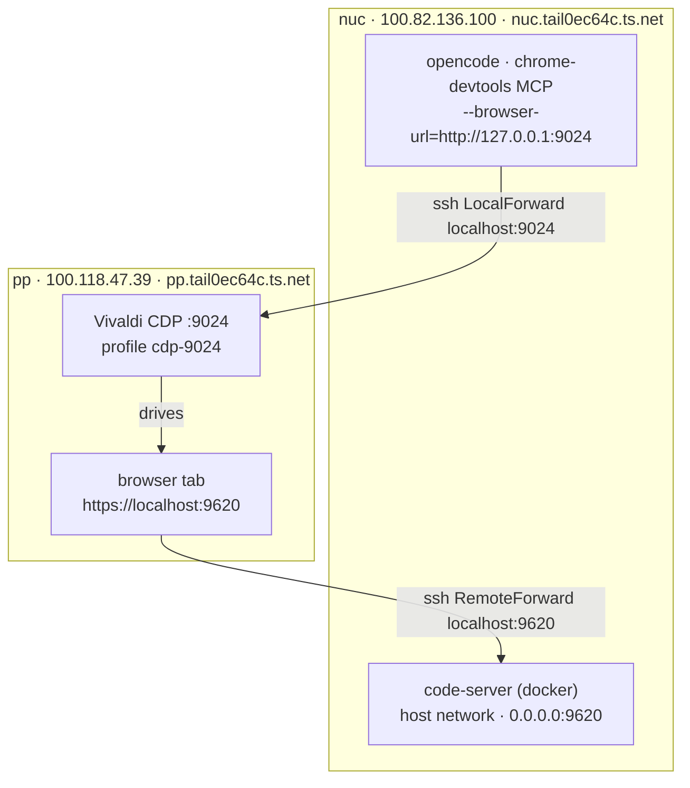

# Dev on nuc, test on pp

Setup for editing code on **nuc** (this machine) via code-server, and testing it in a
real Chromium browser running on **pp**, driven over CDP from opencode's MCP tools.

For a self-contained alternative without pp or ssh, jump to
[the local `chromium` service](#local-alternative-the-chromium-compose-service):
it runs a headed Chromium in Docker with CDP on `9324` and the canvas on `9325`.

## Topology



One `ssh pp` session (transport over the tailnet) carries both tunnels:

- `LocalForward localhost:9024` — nuc's localhost:9024 → pp's CDP port
- `RemoteForward localhost:9620` — pp's localhost:9620 → nuc's code-server port

The browser never talks to nuc over Tailscale directly; it just opens
`https://localhost:9620` and the ssh tunnel carries it back to nuc.

| Thing        | Where        | Address                                  |
| ------------ | ------------ | ---------------------------------------- |
| code-server  | nuc, docker  | `https://localhost:9620` on pp, via ssh RemoteForward |
| CDP browser  | pp           | `pp:9024`, forwarded to nuc `localhost:9024` |
| MCP server   | nuc (opencode) | `chrome-devtools-mcp --browser-url=http://127.0.0.1:9024` |

## Connection details

`~/.ssh/config` on nuc (relevant bits):

```sshconfig
Host pp
    # cdp
    LocalForward localhost:9022 localhost:9022
    LocalForward localhost:9023 localhost:9023
    LocalForward localhost:9024 localhost:9024

    # code-server
    RemoteForward localhost:9620 localhost:9620
```

So as long as `ssh pp` is connected, pp's CDP ports are on nuc's localhost, and
code-server is on pp's localhost. Sanity checks:

```bash
ssh pp                                        # establish the forwards
curl -s http://localhost:9024/json/version    # CDP responds with browser version
ssh pp 'curl -sk https://localhost:9620/healthz'  # code-server reachable from pp
```

The browser on pp is launched as:

```bash
/opt/vivaldi/vivaldi-bin \
  --remote-debugging-port=9024 \
  --user-data-dir=$HOME/.local/share/vivaldi-cdp-profiles/cdp-9024 \
  --ignore-certificate-errors \
  --remote-allow-origins='*' \
  --disable-gpu
```

There are sibling profiles for 9022/9023 (`cdp-9022`, `cdp-9023`) if you need more than
one browser at a time.

### Local alternative: the `chromium` compose service

The same CDP contract can be served from the dev box without pp:

```bash
docker compose up -d chromium
curl -s http://127.0.0.1:9324/json/version   # CDP
# watch it at https://0.0.0.0:9325 (no auth; 1280x720, 16:9)
CDP_PORT=9324 make -C _submodules/vscode-hacker-terminal-enhanced test-e2e
```

It is a headed Chromium on a Selkies Wayland desktop, on the host network so
`https://localhost:9620` works from the browser.

| Endpoint | Address | Notes |
| --- | --- | --- |
| Canvas | `https://0.0.0.0:9325` | Selkies desktop, no auth by default, 1280x720 (16:9) |
| CDP | `http://0.0.0.0:9324` | nginx → Chromium `127.0.0.1:9222` |
| REST Control | `http://127.0.0.1:40620` | loopback only, shared with code-server |

The browser profile lives in `exp/chromium`; code-server runs with
`--auth none`, so the first run lands straight in the workbench at
`https://localhost:9620` with no login, and later runs reuse the session.

Details that matter:

- `1280x720` is the **desktop** ratio; Chrome's toolbar makes the page viewport
  shorter. Override with `CANVAS_WIDTH`/`CANVAS_HEIGHT` (e.g. `1920`/`1080`).
- The bookmark bar is hidden by a managed policy in
  `docker/chromium/policies/`. Verify with `chrome://policy`.
- The canvas has **no auth by default**; set `CUSTOM_USER` and `PASSWORD` in the
  compose service to put basic auth back, then
  `docker compose up -d --force-recreate chromium`. CDP is unauthenticated too.
  Both bind `0.0.0.0`, and the canvas desktop has a terminal with passwordless
  `sudo` — trusted network only.
- `docker/chromium/cdp.conf` is the CDP front door. Change the port there, then
  restart the container. `make info` reads that file, so it follows the change.
- The suites default to `CDP_PORT=9024` (the pp browser); set `CDP_PORT=9324`
  for this browser, or they will target pp instead.
- `make info` prints the live addresses, container state, and the installed vs
  package extension versions. It probes CDP, the canvas, code-server `/healthz`,
  and REST Control. It needs `bun`, `docker`, and `curl`; `NO_COLOR=1` disables
  colour and `FORCE_COLOR=1` forces it.

Troubleshooting:

```bash
ss -ltnp | grep -E ':(9324|9325|9222)'   # 0.0.0.0:9324/9325, 127.0.0.1:9222
docker logs --tail 50 vscode-hacker-meta-chromium-1
curl -s http://127.0.0.1:9324/json/version
curl -sk -o /dev/null -w '%{http_code}\n' https://127.0.0.1:9325/
```

See the design log
[`2026-11-04-headed-chromium-and-make-info.md`](../../plans/2026/11/04/2026-11-04-headed-chromium-and-make-info.md)
for the port/CDP/auth/policy trials and lessons.

## code-server

`docker-compose.yml` (repo root) builds `vscode-hacker-meta/code-server:4.139.1`
from `docker/code-server` (base `codercom/code-server:4.139.1`) and runs it with
`network_mode: host` and `--bind-addr 0.0.0.0:9620`:

- config mounted from `./dot-config/code-server/config.yaml`
  (`auth: none`, matching the compose `--auth none`; no login prompt)
- user data (extensions, settings, logs) mounted from `exp/code-server/.local/share/code-server`
- repo mounted read-only from `${HOME}/git`
- runs with **`--disable-workspace-trust`** (compose `command:`): the session is
  treated as trusted, so user extensions activate without a trust prompt and
  without per-extension `capabilities.untrustedWorkspaces`. The container only
  reaches the mounted git tree + config, so this is "trust the mounts".

Restart after any change (the `hotload` shell function = `kill` + `up -d --no-deps --force-recreate`):

```bash
hotload code-server        # no -f so it doesn't follow logs
docker logs --tail 20 code-server
```

Healthy startup logs look like:

```
Using user-data-dir /home/lamnt45/.local/share/code-server
Using config file /home/lamnt45/.config/code-server/config.yaml
HTTPS server listening on https://0.0.0.0:9620/
  - Authentication is disabled
  - Using certificate for HTTPS: /home/lamnt45/.config/code-server/localhost.pem
```

Then open `https://localhost:9620` in the pp browser; there is no login prompt.
The ssh `RemoteForward` carries it back to nuc.

## Installing extensions on other machines

`make install-ssh` (→ `scripts/install-ssh.ts`) pushes local builds to the
code-server hosts listed in `~/.ssh/config`:

```bash
make install-ssh                                   # pick extensions + hosts
make install-ssh ARGS="--all --dry-run"            # preview, no build/install
make install-ssh ARGS="-e hacker-markdown -H pp,mac"
```

- Two checkbox lists: extensions (all preselected) then concrete `Host` aliases
  (none preselected). `space` toggles, `a` all, `enter` confirms, `q` quits.
  Without a TTY, pass `-e`/`-H` or `--all`.
- Only missing/stale VSIXs are built (`--build` forces, `--no-build` installs
  the existing file). "Stale" means a packaged file is newer than the VSIX.
- One tar stream per host; the remote side installs into the code-server that
  is **actually running** — it reads the `out/node/entry` process rather than
  trusting `PATH` (pp's `/usr/bin/code-server` is an old 4.132.0, mac's
  `~/.local/bin` is not the running copy, and wsk has no CLI on `PATH`).
  It also honours a running `--user-data-dir`.
- `--target auto` (default) prefers code-server and falls back to `code`;
  `--target code` / `code-server` pin it. `-j N` sets host parallelism (default
  4).
- SSH uses keys only (`BatchMode`), accepts new host keys, and passes
  `ClearAllForwardings=yes`, so pp's many `LocalForward`/`RemoteForward` rules
  do not bind ports or print warnings during install.

Reload each target window once afterwards so a fresh extension host loads the
build. The detection rules and the trial-and-error behind them are in the
[design log](../../plans/2026/11/04/2026-11-04-install-ssh-multi-host.md).

## TLS certificate

Self-signed via mkcert, signed by the local mkcert CA (`~/.local/share/mkcert`, present on
both nuc and pp). The browser connects as `localhost:9620`, so the `localhost`/`127.0.0.1`
SANs are what matter; the `*.ts.net` names are belt-and-braces in case you ever hit nuc
directly over the tailnet. Regenerate when the tailnet name/IP changes:

```bash
CAROOT=$HOME/.local/share/mkcert mkcert \
  -cert-file ./dot-config/code-server/localhost.pem \
  -key-file ./dot-config/code-server/localhost-key.pem \
  "*.tail0ec64c.ts.net" tail0ec64c.ts.net nuc.tail0ec64c.ts.net nuc \
  localhost 127.0.0.1 ::1 100.82.136.100 192.168.1.17

hotload code-server
openssl x509 -in ./dot-config/code-server/localhost.pem -noout -ext subjectAltName
```

Notes:

- X.509 wildcards match one level only: `foo.tail0ec64c.ts.net` works, `a.b.tail0ec64c.ts.net` does not.
- Trust requires the mkcert CA in the client trust store. pp's CDP Vivaldi passes
  `--ignore-certificate-errors`, so it works there regardless.
- A publicly-trusted `*.ts.net` wildcard is not possible (you don't control `ts.net` DNS).
  `tailscale cert nuc.tail0ec64c.ts.net` can issue a real per-node cert (needs HTTPS certs
  enabled in the tailnet), but never a wildcard.

## Recovery runbook (when the workbench looks dead)

Symptom → cause → fix, from a session that hit all of these:

| Symptom | Cause | Fix |
| --- | --- | --- |
| REST `:40620` not listening; pure `custom.eval` works but `executeCommand` / config `update` hang | Workspace is **untrusted** (Restricted Mode) → user extensions not activated | The harness recreates code-server with `--disable-workspace-trust`, so this means the flag is gone — recreate the container (`docker compose up -d --force-recreate code-server`). Against a code-server without the flag: status bar → **Restricted Mode** → *Trust*, reload. Check `vscode.workspace.isTrusted`. |
| `chromium.connectOverCDP('http://127.0.0.1:9024')` connects the socket then times out | Stray blank / Vivaldi start-page targets stall target attach | Close them: `curl -s http://127.0.0.1:9024/json/close/<targetId>` (from `/json/list`), retry |
| `PREVIEW_TIMEOUT` / palette input types into nothing while the preview is visibly open | A stray `chrome://newtab` or `about:blank` tab is the first CDP `page` target; helpers that pick pages by order drive it | Probe pages for `.monaco-workbench` (markdown repo's `openWorkbenchPage()`), or close the stray tabs; never index page targets by order |
| After several suites: `showTextDocument` never resolves (a plain `vscode.open` still works), deep scans hit a preview iframe with no document, `NO_PREVIEW` | Accumulated workbench rot — piled-up preview panels, orphaned iframes, stale extension host | Restart **both** `code-server` and `chromium`, reopen the workspace, re-run `open_view.ts`; a window reload alone can leave the half-dead page |
| Browser restarted on the code-server **login page** | Auth is back on: compose lost `--auth none`, or the config says `auth: password` | Restore `--auth none` (compose command + config) and recreate code-server |
| A `*`/`onStartupFinished` extension never activates | Not installed for this profile, or trust | Confirm with `code-server --list-extensions --user-data-dir … --extensions-dir …`; check `logs/<ts>/exthost*/remoteexthost.log` |
| A "missing command" error after a container recreate | Fresh host has not activated the extension (`onCommand:` gating) | Invoke the command once to force activation before enumerating commands |
| Settings you didn't change are different | A test mutated them; settings persist | Restore from VS Code **local history** (`…/code-server/User/History/<id>/*.json`) |

Prefer the order: check trust → prune stray CDP targets → reload the tab
**once** → restart the **browser** (`docker compose restart chromium`; the
profile keeps the code-server session, but tabs are dropped, so navigate back to
the workspace URL) → *only then* recreate code-server. With
`--disable-workspace-trust` a recreate no longer resets trust, but the open tab
goes stale, and (per the general playbook) repeated reloads leave orphaned
extension hosts that keep squatting the REST port.

## Gotchas

- **A wedged workbench is cured by restarting the browser, not by navigating again.**
  After a code-server recreate the old tab can reconnect with a stale session
  token (code-server logs `Unknown reconnection token (never seen)`), and
  `connectOverCDP` / `Runtime.evaluate` then hang during navigation even though
  `/json/list` shows the workbench page. `docker compose restart chromium` and
  navigate to `https://localhost:9620/?folder=…`; the `exp/chromium` profile
  keeps the session.
- **`command: |` with `\` line continuations in docker-compose breaks code-server flags.**
  YAML keeps the newlines, compose turns `\`+newline into a literal `\n` in the next argv
  token, so `--config`/`--user-data-dir` are not parsed (they land in positional args).
  Symptom: `Wrote default config file to /home/coder/...`, a random password, `Not serving
  HTTPS`. Fix: use exec-form `command:` list entries (see `docker-compose.yml`).
- **If you bypass the tunnel and hit nuc directly over the tailnet, use the `.ts.net`
  hostname, not the raw tailnet IP.** pp's Vivaldi inherits
  `https_proxy=http://172.16.22.209:8140`; `no_proxy` contains `.ts.net` but not
  `100.82.136.100`, so the IP fails with `ERR_TUNNEL_CONNECTION_FAILED` while the MagicDNS
  name works. The normal `https://localhost:9620` RemoteForward path avoids all of this.
- **`tailscale` on pp is not in the non-interactive PATH.** It comes from linuxbrew and is
  only added by interactive bashrc: `ssh pp 'bash -ic "tailscale status"'`.
- **"Workspace does not exist" dialog** on login: the mounted user-data-dir remembers a
  last-opened folder (e.g. `/home/lamnt45/git/vscode-hacker-meta`) that is not mounted into
  the container. `${HOME}/git` is now mounted (read-only), so the dialog should not appear;
  writes inside code-server's workspace will fail while it stays `ro`.
